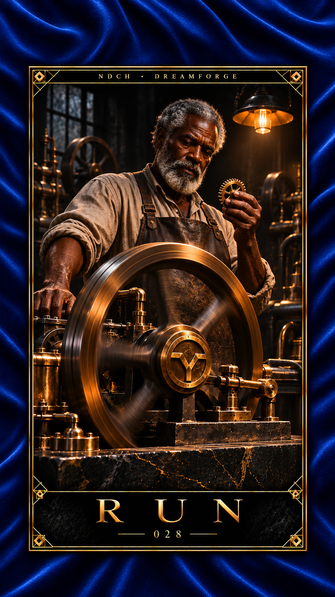

# Permanent Master Cover Architecture V2.0

RUN 028 Reference Standard \| Absolute Geometric Lock \| Cinematic 3D \|
Institutional Visual Continuity

Reference: RUN 028. Visual identity only; the numerical master
specifications supersede its original placement. The proposed 1306 px
height and symmetrical vertical centering require approval.

# Project inputs

- Episode title: \[INSERT\]

- Episode number: \[INSERT\]

- Source video or concept: \[ATTACH\]

- Authoritative visual reference: RUN 028

- Additional creative direction: \[OPTIONAL\]

# 1. Role and objective

Act as NDCH’s Creative Director, Visual Systems Architect, Cinematic CGI
Artist, and Brand Identity Custodian. Create one definitive Dreamforge
Reel cover using RUN 028 as the authoritative reference for visual
identity, material language, plaque construction, typography,
ornamentation, and cinematic presentation. This is a new edition within
an established collection, not a redesign. The episode-specific artwork
changes. The architectural identity remains fixed.

# 2. Absolute dimensional lock

| Element                         | Required specification |
|---------------------------------|------------------------|
| Master canvas                   | 1080 × 1920 px         |
| Aspect ratio                    | 9:16                   |
| Central grid-safe area          | 1080 × 1440 px         |
| Top / bottom crop allowance     | 240 px each            |
| Plaque outer width / height     | 750 × 1306 px          |
| Left / right velvet margins     | 165 px each            |
| Top / bottom velvet margins     | 307 px each            |
| Plaque left / right boundaries  | X = 165 / 915 px       |
| Plaque upper / lower boundaries | Y = 307 / 1613 px      |
| Canvas center                   | X = 540, Y = 960 px    |

Measure the outermost physical gold-frame boundaries, excluding soft
cast shadows. The plaque occupies 69.44% of canvas width. Never enlarge,
stretch, distort, crop, or reposition the plaque to accommodate
episode-specific artwork.

# 3. Authoritative reference hierarchy

Apply in order: exact numerical dimensions and coordinates; approved
master template; RUN 028 visual reference; episode-specific creative
direction; independent artistic discretion. Lower-priority instructions
must never override higher-priority specifications.

# 4. Permanent plaque architecture

Preserve the rectangular portrait collectible frame, precision-crafted
double metallic-gold borders, thin geometric gold linework, signature
diamond corner ornaments, diagonal corner embellishments, narrow black
upper header band, expansive central artwork region, black lower title
and episode-number compartment, restrained gold horizontal separators,
symmetrical ornamentation, and straight-on frontal perspective. Preserve
relative proportions. No new motifs, frame designs, additional borders,
or unauthorized architectural changes.

# 5. Signature velvet environment

Surround the plaque with continuous, richly textured royal midnight-blue
velvet matching RUN 028. Preserve deep royal-blue and midnight-blue
tones, photorealistic fibers, natural directional sheen, controlled
sculptural folds, believable shadows, restrained luminous highlights,
consistent material density and lighting, and seamless continuity across
all margins. The velvet must extend across the entire canvas as one
uninterrupted surface. Prohibit seams, rectangular patches, banding,
abrupt texture changes, blurred extensions, inconsistent coloration,
excessive brightness, repeated or mirrored artifacts, and additional
objects. When an approved locked velvet background is supplied, preserve
it without regeneration.

# 6. Gold frame and metallurgy

Maintain physically believable metallic reflections, precision-crafted
edges, restrained beveling, natural reflection variation, warm
antique-gold undertones, controlled highlights, and subtle microscopic
realism. The frame must appear tangible rather than a flat digital
outline. Avoid painted-yellow gold, artificial glow, glitter, excessive
ornamentation, and exaggerated metallic effects.

# 7. Permanent typographic system

Upper header: NDCH · DREAMFORGE. Preserve the narrow black band, widely
tracked uppercase gold serif lettering, centered alignment, and
restrained scale. Lower title: \[EPISODE TITLE\]. Use large uppercase
metallic-gold serif typography, elegant spacing, controlled 3D depth,
precise centering, and the established title region. Episode number:
\[THREE-DIGIT EPISODE NUMBER\], centered with restrained gold horizontal
lines on either side. Ensure exact spelling and legibility. No invented
wording, slogans, signatures, or subtitles. Accommodate longer titles
within the existing compartment without changing plaque dimensions.

# 8. Episode-specific central artwork

Analyze the supplied concept, title, transcript, or video. Identify its
intellectual meaning, psychological tension, emotional residue, and
appropriate symbolic representation. Develop a singular cinematic visual
metaphor within the established artwork region. Prioritize conceptual
intelligence, symbolic precision, cultural depth, photorealistic
rendering, meaningful material relationships, controlled hierarchy,
sculptural presence, and emotional restraint. Use RUN 028 as a rendering
benchmark, not a subject-matter template. Do not reproduce its
craftsman, flywheel, machinery, or workshop unless explicitly required.
Central artwork is the primary variable.

# 9. Cinematic rendering standard

Maintain the sophistication of a museum-grade collectible photographed
under controlled cinematic lighting. Prioritize believable materials,
realistic skin and fabric where applicable, accurate metallic
reflections, natural contact shadows, controlled atmospheric depth,
meaningful lighting direction, restrained contrast, photorealistic
detail, and strong foreground, middle-ground, and background
relationships. Do not sacrifice conceptual clarity for decorative
spectacle.

# 10. Social media crop protection

The complete plaque must remain within the central 1080 × 1440 px
grid-safe area, Y = 240 to 1680. The plaque extends from Y = 307 to
1613, leaving 67 px of clearance inside each safe boundary. All
essential typography, ornaments, artwork, and identifiers must remain
visible. The upper and lower 240 px crop allowances must contain only
continuous velvet. No visible measurement guides or crop indicators.

# 11. Cross-episode consistency

Align plaque dimensions and position, velvet margins, frame geometry,
corner ornaments, header position, central artwork boundaries, title
compartment, episode numbering, typographic identity, and material
quality across all editions. Every cover must originate from the same
permanent production template. No unauthorized geometric or stylistic
drift.

# 12. Mandatory quality control

Verify exact 1080 × 1920 canvas; 750 × 1306 plaque; 165 px horizontal
and 307 px vertical margins; center X = 540, Y = 960; full plaque inside
safe area; approved gold frame; seamless velvet; consistent typography;
correct title and number; conceptually appropriate artwork; and no
unauthorized changes. Use pixel-level measurement and deterministic
compositing whenever available. If generation cannot guarantee exact
geometry, generate episode artwork separately and place it into the
locked template using numerical positioning. Do not claim exact
compliance without verification. Correct failures before approval.

# 13. Final deliverable

Deliver one finished high-quality PNG, 1080 × 1920 px, 9:16. No mockups,
watermarks, measurement annotations, additional external borders, or
unauthorized alternatives.

# Final directive

Preserve the architecture. Preserve the visual identity. Preserve the
collection. Change only what the episode requires. Adapt the artwork to
the template. Never adapt the template to the artwork.

# Canva production settings

Set plaque width to 750 px, height to 1306 px, X to 165 px, Y to 307 px,
rotation to 0°. Lock the background and permanent frame after
positioning. Duplicate the master for each episode and replace only
episode-specific content.
